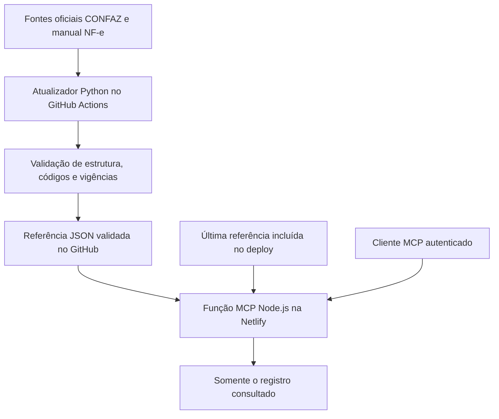

# MCP Fiscal ATS — arquitetura, dados e operação

Referência inicial da documentação: **23/10/2026**.

## 1. Objetivo e escopo

Disponibilizar quatro ferramentas fiscais para uso por clientes MCP, com hospedagem
na Netlify sem Docker, consulta em fontes oficiais e respostas pequenas.
A conexão à Tina é uma etapa posterior e não foi realizada nesta implementação.
A consulta NCM do Siscomex já utilizada pela ATS é preservada.

Repositório: https://github.com/PauloVictor1803/mcp-fiscal-brasil-kosmus

Painel de teste: https://ats-fiscal-mcp-kosmus.netlify.app

Endpoint MCP: https://ats-fiscal-mcp-kosmus.netlify.app/mcp

Os endereços acima identificam o site criado. A confirmação da publicação e da
rotina automática fica registrada na seção de validação ao final deste documento.

## 2. Ferramentas

| Nome | Entrada | Resultado |
| --- | --- | --- |
| `consultar_cfop` | `cfop`, como `1403` ou `1.403` | Descrição oficial, entrada/saída, âmbito e referência |
| `validar_chave_nfe` | `chave`, com 44 dígitos; aceita espaços | Formato numérico e dígito verificador |
| `validar_cst` | `cst` e `tributo` | Descrição na tabela correta e situação do código |
| `consultar_cest` | `cest`, como `0100700` ou `01.007.00` | Descrição, texto NCM/SH oficial, situação e referência |

Tributos aceitos: `ICMS`, `CSOSN`, `IPI`, `PIS` e `COFINS`.
ICMS aceita dois dígitos de CST ou três no formato origem+CST. CSOSN exige três;
IPI/PIS/COFINS, dois. Os códigos são strings para preservar os zeros iniciais.
Não há tentativa de inferir o tributo a partir do número.

A chave é validada matematicamente. Isso não confirma autorização, existência da
nota, situação do emitente, validade da assinatura ou disponibilidade da SEFAZ.
Consultar um código fiscal não define sua aplicação à operação do cliente.

## 3. Arquitetura



O Python participa da manutenção dos dados no GitHub Actions. A função publicada
na Netlify executa Node.js 22+; não depende de um processo Python, Docker, certificado
digital ou provedor fiscal pago para essas quatro ferramentas.

## 4. Fontes oficiais e cobertura inicial

| Conjunto | Fonte | Registros na reconstrução inicial |
| --- | --- | ---: |
| CFOP | Anexo II consolidado do SINIEF | 619 códigos operacionais |
| CEST | Anexos II a XXVI do Convênio ICMS 142/18 | 1.052 registros, incluindo revogados e futuros |
| ICMS | Tabela B do SINIEF consolidado | 20, incluindo códigos revogados |
| Origem da mercadoria | Tabela A do SINIEF | 9 |
| CSOSN | Anexo do SINIEF | 10 |
| IPI | MOC NF-e 7.0, Anexo I | 14 |
| PIS | MOC NF-e 7.0, Anexo I | 33 |
| COFINS | MOC NF-e 7.0, Anexo I | 33 |

Links de origem:

- CFOP: https://www.confaz.fazenda.gov.br/legislacao/ajustes/sinief/cfop_cvsn_1-6.24/
- CEST: https://www.confaz.fazenda.gov.br/legislacao/convenios/2018/CV142_18
- ICMS, origens e CSOSN: https://www.confaz.fazenda.gov.br/legislacao/ajustes/sinief/cvsn_70
- Manual NF-e: https://www.confaz.fazenda.gov.br/legislacao/arquivo-manuais/moc7-anexo-i-leiaute-e-rv.pdf

Na referência de 23/10/2026, o CEST possui 1.041 registros ativos, 8 revogados e
3 de vigência futura. A contagem total não significa que todos os códigos estejam
vigentes. As quantidades podem mudar nas próximas atualizações oficiais.

O NCM/SH indicado no CEST é a transcrição do respectivo anexo, inclusive posições
parciais; não é uma nova tabela NCM. Não se completam dígitos por inferência.
Quando o próprio texto oficial apresenta uma associação NCM/SH que exige
conferência, a ferramenta sinaliza isso e orienta usar a fonte Siscomex existente.

## 5. Atualização automática

Arquivo responsável: `.github/workflows/atualizar-tabelas.yml`.

Programação: diariamente às **09h23 UTC / 06h23 de Brasília**. O GitHub pode atrasar
a execução; esse horário não é garantia de atualização instantânea.

Etapas:

1. Baixar os documentos oficiais por HTTPS.
2. Separar códigos operacionais de cabeçalhos de grupo e versões históricas.
3. Selecionar a redação aplicável à data de referência.
4. Identificar revogações e textos que só produzirão efeitos no futuro.
5. Conferir estrutura, quantidades plausíveis, exemplos de regressão e tabelas por tributo.
6. Executar os testes do MCP.
7. Gravar no GitHub somente o JSON validado, com URLs, hashes e data de referência.

A Netlify consulta esse JSON em endereço fixo do próprio repositório, com cache
em memória de até uma hora por instância. Não há consulta de toda a legislação
a cada conversa, nem necessidade de reconstruir o site diariamente.

Se houver erro de rede, mudança estrutural da página ou falha na validação, a
rotina falha e conserva a referência anterior. Uma falha no GitHub deve ser
investigada no histórico de Actions. Uma referência com mais de dois dias é
sinalizada na resposta como `atualizacao_atrasada: true`.

A automação acompanha as publicações disponíveis nas fontes consultadas. Ela
não recebe notificação direta do governo e não promete atualização imediata após
cada publicação. Mudanças de formato ou de leiaute podem exigir manutenção.

## 6. Vigência e redações históricas

O documento CEST reúne redação atual, redações anteriores, exemplos e retificações.
O importador seleciona os anexos de cadastro, considera as notas de produção de
efeitos e evita que uma redação futura substitua a atual antes da data correta.

Caso confirmado: alterações dos CEST 21.046.00 e 21.047.00 e novos subitens com
efeitos em **01/11/2026**. A importação foi testada com referência em 23/10/2026 e
em 01/11/2026. Se uma redação antiga expirar e o serviço não tiver atualizado a
base, ele informa `referencia_expirada`, sem apresentar a descrição antiga como atual.

Os estados `revogado`, `vigencia_futura` e `aguardando_atualizacao` são resultados
distintos de um código ativo. Ausência na base não é tratada como prova de código inválido.

## 7. Economia de contexto

- Apenas quatro ferramentas são anunciadas em `tools/list`.
- Descrições curtas, sem injetar manuais ou instruções globais extensas.
- Uma chamada consulta um código, sem devolver tabelas completas.
- Cada resultado ocupa um único bloco de conteúdo, sem duplicação em texto e JSON.
- Hashes, auditoria e arquivos de origem permanecem no serviço/repositório.
- O validador de chave não repete chave, CNPJ ou dados extraídos na resposta.
- Os testes conferem tamanho em todos os registros, com limite de 3 KB por resultado.

Esses limites são em bytes, não em tokens. A quantidade efetiva de tokens depende
do modelo e de como a plataforma apresenta os resultados das ferramentas.

## 8. Autenticação e configuração

O endpoint exige `Authorization: Bearer <AUTH_TOKEN>`.
O valor da chave não aparece neste documento, no GitHub ou na página pública.
No plano gratuito, foi autorizada pelo responsável a utilização da variável de
ambiente padrão da Netlify, acessível aos administradores da conta.

`TABLES_AUTO_UPDATE=true` habilita a leitura da referência validada no GitHub.
Sem chave configurada, um endereço público falha fechado.
Há validação de Origin e limite de 8 KB para o corpo da requisição.

Suporta Streamable HTTP com respostas JSON e negociação das versões MCP
2025-03-26, 2025-06-18 e 2025-11-25. Notificações aceitas recebem 202 sem corpo;
GET/SSE e DELETE não são oferecidos e retornam 405.

Exemplo sem credenciais:

```json
{"jsonrpc":"2.0","id":1,"method":"tools/call","params":{"name":"consultar_cfop","arguments":{"cfop":"1403"}}}
```

Cabeçalhos: `Content-Type: application/json` e
`Accept: application/json, text/event-stream`, além da autenticação.

## 9. Testes e manutenção

Execução local, dentro de `netlify-mcp`:

```sh
npm test
npm start
```

Atualização manual pela raiz do repositório:

```sh
pip install requests beautifulsoup4 pypdf
python scripts/atualizar_tabelas_oficiais.py --fontes-dir ./tmp/fontes --download
node --test netlify-mcp/test/mcp.test.js
```

Em caso de falha, investigar o documento que mudou e o teste afetado; não remover
as validações apenas para fazer a publicação passar. Revisar o histórico de Actions
e a data de referência antes de usar uma tabela aparentemente desatualizada.

Os primeiros dados do fork foram reprovados. A auditoria histórica está em
`netlify-mcp/docs/AUDITORIA-TABELAS.md`; os dados atuais foram reconstruídos em
fontes oficiais. Passar em testes de transporte não equivale a certificar conteúdo fiscal.

## 10. Conexão futura à Tina

A conexão não foi feita. Em uma etapa posterior, cadastrar o endereço `/mcp`, a
chave em Segredos e o filtro das quatro ferramentas. Validar primeiro os casos de
uso na homologação. O NCM atual do Siscomex permanece separado.

Configuração:

| Campo | Valor |
| --- | --- |
| URL | `https://ats-fiscal-mcp-kosmus.netlify.app/mcp` |
| Nome do segredo na Tina | `MCP_FISCAL_TOKEN` |
| Valor do segredo | Copiar o valor de `AUTH_TOKEN` das variáveis do projeto na Netlify |
| Cabeçalho | `Authorization` |
| Conteúdo do cabeçalho | `Bearer {{segredo:MCP_FISCAL_TOKEN}}` |
| Filtro | `consultar_cfop,validar_chave_nfe,validar_cst,consultar_cest` |

O token é uma chave de acesso ao serviço da ATS, não uma exigência do governo
para consultar os dados públicos. A Tina o envia automaticamente; o cliente
atendido não precisa informar ou conhecer esse valor. Tokens de consumo de IA
são outro conceito. Não copiar o token real para esta documentação.

## 11. Confirmação operacional

- Código e dados oficiais: reconstruídos e testados localmente.
- Publicação Netlify: concluída, com autenticação e consultas verificadas em produção em 23/10/2026.
- Rotina diária: instalada no ramo principal; primeira execução falhou por timeout de conexão ao CONFAZ. Duas tentativas falharam pelo mesmo timeout; a base anterior foi preservada. A programação está ativa, mas a obtenção diária de novas fontes ainda não foi comprovada.
- Tina: não alterada.

## 12. Créditos e custos de operação

O atualizador não usa modelos de IA. Seu processamento ocorre no GitHub Actions.
Não há deploy diário na Netlify: a função busca o JSON validado com cache de uma hora.
Consultas usam requisições, processamento e tráfego da franquia Netlify.
O AUTH_TOKEN é uma senha, não um saldo de créditos.

No plano gratuito com créditos, o saldo mensal renova no início do ciclo de faturamento;
créditos mensais restantes não acumulam. Conferir a data em Uso e faturamento > Saldo de créditos.
Referência: https://docs.netlify.com/manage/accounts-and-billing/billing/billing-for-credit-based-plans/billing-faq-for-credit-based-plans/

Limitação herdada: a auditoria de dependências do projeto Python original aponta vulnerabilidades no uv.lock.
Esse projeto não é instalado pelo MCP Netlify. Os testes MCP, CI e CodeQL da versão final passaram.

Verificações finais:

- PR integrado: https://github.com/PauloVictor1803/mcp-fiscal-brasil-kosmus/pull/1
- Execução automática e diagnóstico de rede: https://github.com/PauloVictor1803/mcp-fiscal-brasil-kosmus/actions/runs/40009121713
- Commit integrado: e84ed718c9a349526e16b2820bb2f688c505028e
- Próxima ação de manutenção: resolver o acesso HTTPS do executor ao CONFAZ e repetir a execução até validar download, reconstrução, testes e gravação. Não alterar fontes nem desativar validações para mascarar falhas.
